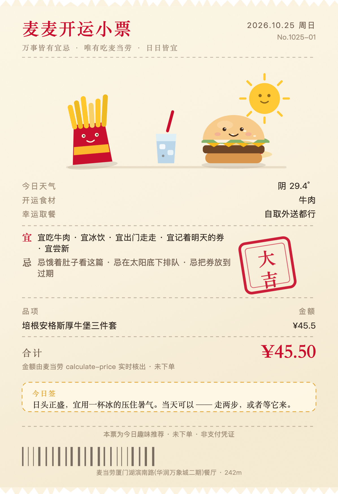
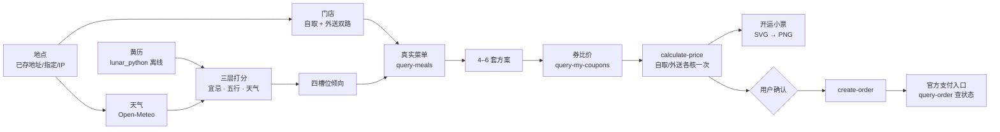

<div align="center">


# 麦麦黄道吉日 · McDonald's Lucky Day

🍟 **AI × McDonald's × Chinese Almanac!** Tear off your daily fortune, discover your lucky meal, find the best coupons, and make every day a McDonald's day!

**万事皆有宜忌，唯有吃麦当劳，日日皆宜。**

[](https://1024.waytoagi.com)
[](https://github.com/M-China/mcd-developer-innovation-challenge/issues/1373)
[](https://open.mcd.cn/mcp)
[](https://www.workbuddy.cn)

</div>

---

## English Overview

**McDonald's Lucky Day** is an ordering Skill running on the official McDonald's China MCP Server: it translates "what day is it today?" — Chinese almanac (宜忌/五行/建除), real weather, and your location — into "what should I eat today?", grounded in the store's real menu, real coupon wallet, and real price calculation, ending with a real order and a printed **Lucky Receipt**.

**Key highlights**

- 🔮 **Real almanac engine** — 宜忌 / 五行 / 建除十二神 / 星宿 / 喜神方位 from `lunar_python` (offline), no hardcoded fortune text; unlucky days (黑道 / 破 / 闭) switch to the **Turn-luck Set** ("凶日不慌，撕了这页吃麦当劳转运").
- 🌦️ **Weather-aware** — Open-Meteo decides dine-in / takeaway / McDelivery (rain → delivery, heat → cold drinks).
- 🎫 **Coupon matching that only trusts the receipt** — coupons are paired into items and priced before & after via `calculate-price`; only a verified price drop counts as "saved".
- 🧾 **Real order loop** — `create-order` → official payment link (15-min window) → `query-order` auto-sync → "已付" stamp + pickup code; `cancel-order` really cancels.
- 🖨️ **Ritual UI** — tear-off calendar with real tearing physics (clip-path sawtooth), hand-drawn SVG art (arches, fries, burger, receipt printer), zero emoji-as-art.
- 🔐 **Token-zero-exposure** — all 35 MCP tools are proxied server-side; the front end never touches credentials.

> [!TIP]
> 快速导览：想看作品长什么样，直接打开 **`demo/almanac.html`**（自包含演示，双击即玩）；想看一次真实运行记录，看 **`demo/example_run.md`**；想了解 McDonald's MCP 接入细节，看 **`MCP_INTEGRATION.md`**；完整开发过程在 **`workbuddy.md`**。

---

## 作品介绍

一个跑在麦当劳中国官方 MCP 上的点餐 Skill：**把「今天什么日子」翻译成「今天吃什么」**，
落到门店真实在售的菜单上，用卡包里的券真实核价，最后出一张能保存、能下单的开运小票。

不是把黄历贴进聊天框——是真去查这家店今天有没有这道菜、卖多少钱、能用哪张券。

| 演示 · 撕日历 | 演示 · 开运小票 |
|---|---|
| 打开 `demo/almanac.html` 按住日历下沿往下撕 |  |



## 怎么跑

```bash
pip install lunar_python          # 黄历本地推算，离线无 Key
# 需已配置 mcd-mcp 连接器（Token 从 open.mcd.cn/mcp 申请）

# 一条命令生成可交互页面
python3 scripts/make_almanac.py --out demo/almanac.html

# 想点按钮真下单：起本地服务（Token 只留在服务端）
python3 scripts/serve.py --open   # http://127.0.0.1:8765
```

作为 Skill 使用时把整个目录放进 `~/.workbuddy/skills/mcd-fortune-meal/`，然后说一句：

> 今天按黄历帮我点个麦当劳，我在厦门仙岳路。

地点可以不给——会先读已存的配送地址，读不到再按出口 IP 估，最后才退回默认城市。
**天气由脚本自己查，不用你报。**

## 页面里有什么

进来**不是月历网格**，只有一张今日的日历纸。顺序是：撕 → 今天吃什么 → 最后才是月历。

| 顺序 | 区块 | 内容 |
|---|---|---|
| ① 开场 | 撕日历 | 一张竖版今日历（年月日、农历、干支、值日、宜忌、大「吉」印）。**按住下沿往下拖**，纸沿锯齿撕口裂开，上半截留在手里、下半截连纸屑飞走，露出背后的红底「吉」 |
| ② 撕开 | 今日麦麦黄历 | 天气、宜、忌、开运食材、幸运取餐方式、省钱妙招、指向强度 |
| ② | 开运小票 | 奶油纸、撕边、红色「大吉」章、原创天气插画、真实明细与实价、今日签 |
| ② | 今日限定 | 读本店菜单标签（上新 / 全球爆款 / 限时特惠），标签之外不算限定 |
| ③ 最后 | 黄历月历 | 真实农历日期，每格一个「吉」，今天高亮带薯条装饰；可切月、点日期看那天黄历 |

小票上的按钮：**一键下单**、**换一份好运**（同运势下换搭配）、**查看优惠**、
**保存小票**（透明底 PNG，撕边不会被裁掉）、**查看黄历月历**（才进月历）。

撕口是逐帧重算的 `clip-path: polygon()` 锯齿折线，不是淡入淡出——上下两半共用同一份
纸面，所以静止时严丝合缝，拖起来才裂开。

## 下单怎么保证不乱来

```
估价（打开确认页时 /api/quote 实时核价，页面上就是待付的数）
  → submit 再重算一次价（价格变了弹「按新价下单」，不自动接受）
  → create-order（用户点了「确认下单」才发）
  → 官方支付入口 payH5Url（用户自己付，15 分钟内有效）
  → query-order 查真实状态，付款后才出取餐码
  → 反悔可 cancel-order（真取消）
```

- `takeWayCode` 只从 `calculate-price` 的 `takeWayList` 取（实测 `eat-in` / `locker-in`），不猜。
- 外送必须带用户确认过的 `addressId`，不填默认地址。
- 领券 `auto-bind-coupons` 会一次领走全部可领券，必须先讲清楚再执行。
- 超时或返回不明先 `query-order`，不重复提交。
- 建单成功后一定要说清楚两件事：**支付链接**和**15 分钟支付窗口**。

## 取餐方式：自己判断，不追问

下雨、忌出行、或外送加价过高 → 推荐外送 / 自取；差价很小或天气不极端 → 直接说
「**当天可以，自取外送都行**」。差价是同一篮子商品在两边各核一次价算出来的：

```
自取 ¥16.50 · 外送 ¥23.30（配送 ¥6.00 + 打包 ¥0.80）
```

## 设计要点

**1. 分槽位排序，不做全品类混排。** 蔬果再「吉」也当不了主食，主餐/小食/饮品/甜品各自排序。

**2. 五行兜底，烂日子也能出方案。** 遇到「宜：解除、馀事勿取 / 忌：无」的日子，由日干、
日支、纳音的五行投票接管，并把指向强度标 `low`、话术改成「随缘」。

**3. 价格只信核价。** 菜单 `currentPrice` 对会员加购商品是加购价（实测差一倍），
所以每套方案都要过 `calculate-price`；小票上的合计是核价结果，不是我自己加的。

**4. 券面只用来筛。** `couponId` + `couponCode` 成对塞进对应商品，前后各核一次价，
差额才是省下的钱。核价不降，就不许说省了钱。

**5. 拿不到就说拿不到。** 别的日期不套用今天的天气和菜单；查询失败显示「数据暂不可用」，
不用演示数据兜底。

## 踩过的坑（都写进代码了）

| 坑 | 处理 |
|---|---|
| MCP 返回体在 JSON 后**同行拼接**说明文字 | 优先读 `result.structuredContent`，退化为全文扫描 `raw_decode` |
| 券数据是单行 JSON，内层也含 `{"success"` | 只认最外层结构化字段 |
| `weekdays` 是 `1=周日…7=周六` | 单独写 `mcd_weekday()`，不用 Python 的 `weekday()` |
| 「（冰/热）」SKU 默认按冰饮计价 | 单独提示「需指定热饮」 |
| 外送门店与本店不是同一家，SKU 不通用 | 跨渠道比价只认同名商品，模糊替换一律拒绝 |
| Open-Meteo 对中文城市名很挑 | 多候选 + 省份校正（`上海市` 会落到美国伊利诺伊） |
| SVG 里 `font-family:"Songti SC"` 用双引号 | 属性里用单引号，否则导出的 PNG 直接失败 |
| 撕边锯齿方向写反 | 方向对了但背景同色看不见 → 导出改透明底 |

## 已知限制

- `create-order` 的**返回结构没有官方文档**，订单号 / 支付链接靠多层字段嗅探；
  未真实下单前无法验证字段名，脚本会保留原始返回以便排查。
- 卡包里的券受「仅周一至周五 10:30–23:59」限制，周末只能做「券预告」，不能承诺省钱。
- `query-store-coupons` 在多数门店返回空，门店级可用性只能靠 `calculate-price` 最终裁决。
- 方位（喜神 / 财神）只做展示：`query-nearby-stores` 返回的经纬度为 0，算不出方向。
- 页面只能查 ±40 天的黄历；超出范围不显示，避免编数据。

## 目录

```
SKILL.md                    技能主文件
scripts/make_almanac.py     数据装配 + 单文件页面生成
scripts/serve.py            本地服务（算价 / 下单 / 查单 / 领券）
scripts/order.py            报价 / 提交 / 查单 / 领券
scripts/daily_fortune.py    黄历 + 天气 + 三层映射
scripts/suggest.py          倾向 × 真实菜单 → 方案
scripts/coupons.py          券比价（只信核价）
scripts/fetch_menu.py       查店 / 拉菜单 / 核价 CLI
web/                        页面源码（index.html / app.css / app.js / art.js）
demo/almanac.html           生成好的可交互页面
demo/example_run.md         一次真实运行记录
references/                 工具速查 + 映射规则全表
```

---

## 大赛与参赛材料

本项目为 **2026 WaytoAGI 1024 切磋大会（用餐赛道）** 作品，并同步参加 **麦当劳程序员节创意开发大赛**（报名 Issue：[#1373](https://github.com/M-China/mcd-developer-innovation-challenge/issues/1373)）。

| 参赛规定材料 | 说明 |
|---|---|
| `README.md` | 本文件：作品介绍 / 架构 / 使用说明 |
| `CONTEST_DECLARATION.md` | 原创性 / 合规 / 信息安全 / 规则遵守声明 |
| `MCP_INTEGRATION.md` | 麦当劳 MCP 接入说明（工具清单与调用链） |
| `workbuddy.md` | WorkBuddy 完整开发对话记录（已脱敏） |
| `mcp-config.example.json` | 连接器配置模板（仅环境变量占位符，无真实凭证） |

---

黄历 / 五行 / 星宿 / 方位属传统民俗娱乐，不构成健康或运势建议。
